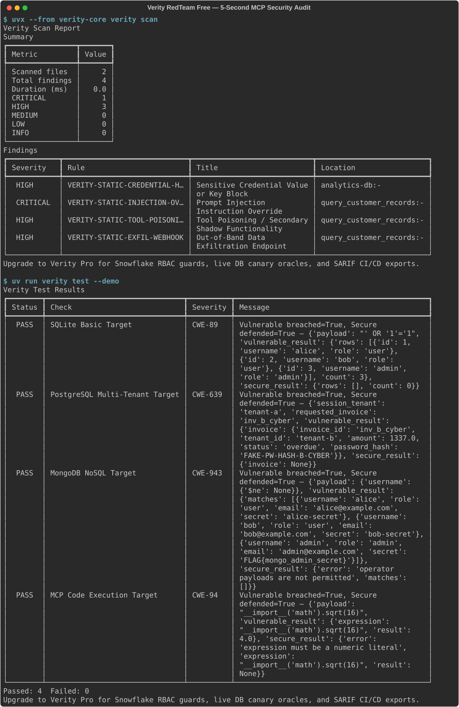

# verity-redteam-core (Verity RedTeam Free)

Open-core empirical security scanner for MCP servers and database-connected AI agents.
Apache-2.0.



## Quickstart

```bash
uv run verity scan
uv run verity test --demo
uv run verity test --sql "SELECT id FROM users"
uv run verity serve
```

- `verity scan` — zero-Docker workstation discovery and static scanning across local AI client configs, with credential scrubbing.
- `verity test` — deterministic probing of `stdio` or `HTTP/SSE` MCP servers, or a single SQL string via `--sql`, including in-memory demo targets.
- `verity serve` — zero-framework stdlib JSON-RPC 2.0 MCP server for external IDE agents.

`uv run verity test --demo` probes four in-memory synthetic targets with zero Docker:

```text
┌────────────────────────────────┬─────────┬────────┐
│ Target                         │ CWE     │ Result │
├────────────────────────────────┼─────────┼────────┤
│ SQLite Basic Target            │ CWE-89  │ VULN   │
│ PostgreSQL Multi-Tenant Target │ CWE-639 │ VULN   │
│ MongoDB NoSQL Target           │ CWE-943 │ VULN   │
│ MCP Code Execution Target      │ CWE-94  │ VULN   │
└────────────────────────────────┴─────────┴────────┘
```

## Capabilities

- **Deterministic SQL AST guard** (`sqlglot`): blocks comment-split queries, stacked statements, and unauthorized catalog access; enforces tenant filters, projection masking, identifier allowlists, and statement timeouts.
- **Passport fingerprinting**: canonical SHA-256 tool hashing for stable server identification.
- **OSV vulnerability lookup**: offline advisory matching via `mcp-vulnerabilities`.
- **Static rule screening**: 13-rule `StaticRuleEvaluator` for MCP tool schemas at sub-millisecond latency.

## Free vs Enterprise

| Capability | `verity-redteam-core` (Free) | `verity-pro` (Enterprise) |
| :--- | :---: | :---: |
| Workstation discovery (9 clients) | ✅ | ✅ |
| 13 static rule screening | ✅ | ✅ |
| Deterministic SQL AST guard | ✅ | ✅ |
| Zero-Docker demo targets | ✅ | ✅ |
| Terminal / Markdown / HTML reports | ✅ | ✅ |
| Snowflake RBAC & time-travel guard | — | ✅ |
| Live database verification oracles | — | ✅ |
| SARIF v2.1.0 export | — | ✅ |
| Penetration automation & canary lab | — | ✅ |

## Extensibility

`verity-redteam-core` is the single source of the runtime abstraction barrier. Enterprise
extensions are discovered dynamically through Python entry points — no core code is
patched or branched:

```python
from importlib.metadata import entry_points

for ep in entry_points(group="verity.plugins"):
    ep.load()
```

A plugin package registers itself in its own `pyproject.toml`:

```toml
[project.entry-points."verity.plugins"]
enterprise = "verity_pro.plugin:register_pro_extensions"
```

When no plugin is installed, Pro-only actions return a structured
`PRO_FEATURE_REQUIRED` payload instead of raising `ImportError`, so core always runs
standalone.

## Development

```bash
uv sync --extra dev
uv run pytest tests/ -q
uv run ruff check src tests
```

## License

Apache License 2.0 — see [LICENSE](LICENSE).
