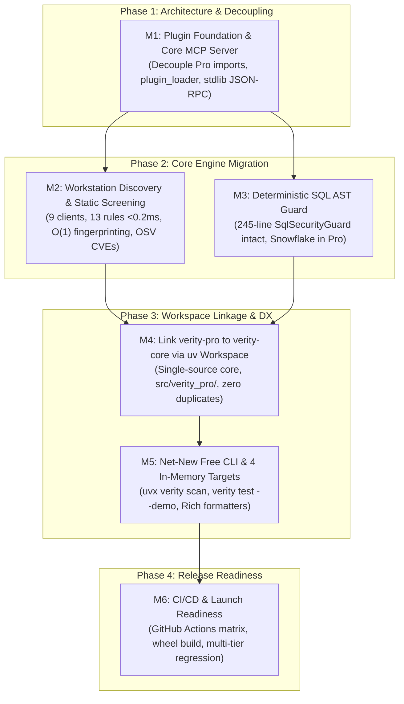

# Verity RedTeam Free — Engineering Task Board

> **Project**: Verity RedTeam (Free / Open-Core Edition)  
> **GitHub Project Board**: [Project #5: Verity RedTeam Free Task Board](https://github.com/users/JMartynov/projects/5)  
> **Target Repository (Free Core)**: [`/Users/ivan/Project/3t.tools.intellij/verityredteam-free`](file:///Users/ivan/Project/3t.tools.intellij/verityredteam-free) (`JMartynov/verityredteam-free`)  
> **Source Repository (Enterprise Pro)**: [`/Users/ivan/Project/3t.tools.intellij/verityredteam`](file:///Users/ivan/Project/3t.tools.intellij/verityredteam)  
> **Status**: Completed (v0.1.0-alpha Released)  
> **Target Baseline**: `v0.1.0-alpha` (Free Core) / `v0.3.0` (Enterprise Pro)  
> **Architecture Plan**: [`open_core_migration_plan.md`](file:///Users/ivan/Project/3t.tools.intellij/verityredteam/docs/plans/open_core_migration_plan.md)  
> **Verification Plan**: [`architecture_review_and_verification_plan.md`](file:///Users/ivan/Project/3t.tools.intellij/verityredteam/docs/plans/architecture_review_and_verification_plan.md)  

---

## 🗺️ High-Level Roadmap & 6-Task Migration Pipeline



---

## 📋 Task Matrix & Status Overview

| Task Key | Task Title | Architectural Scope | Status | GitHub Project #5 Item |
| :---: | :--- | :--- | :---: | :---: |
| **M1** | **Plugin Foundation & Core MCP Server** | Plugin protocols, entry points, stdlib JSON-RPC MCP server | `Done` | [View Item #M1](https://github.com/users/JMartynov/projects/5) |
| **M2** | **Workstation Discovery & Static Screening** | 9-client scanner, 13-rule StaticRuleEvaluator, fingerprinting, OSV cache | `Done` | [View Item #M2](https://github.com/users/JMartynov/projects/5) |
| **M3** | **Deterministic SQL AST Guard** | Cohesive 245-line `SqlSecurityGuard` (`sqlglot`), Pro Snowflake guard | `Done` | [View Item #M3](https://github.com/users/JMartynov/projects/5) |
| **M4** | **Link `verity-pro` to `verity-core` via `uv` Workspace** | `[tool.uv.sources]`, `src/verity_pro/` packaging, remove duplicated core | `Done` | [View Item #M4](https://github.com/users/JMartynov/projects/5) |
| **M5** | **Net-New Free CLI & 4 In-Memory Synthetic Targets** | `verity scan`, `test --demo`, `serve`, Rich tables, 4 zero-Docker targets | `Done` | [View Item #M5](https://github.com/users/JMartynov/projects/5) |
| **M6** | **CI/CD & Launch Readiness** | Multi-platform GitHub Actions matrix, `uv build` wheel, Pro regression | `Done` | [View Item #M6](https://github.com/users/JMartynov/projects/5) |

---

## 🏗️ Detailed Migration Task Specifications

---

### M1: Plugin Foundation & Core MCP Server

#### Master Plan Reference
- [`open_core_migration_plan.md`](file:///Users/ivan/Project/3t.tools.intellij/verityredteam/docs/plans/open_core_migration_plan.md) (Phase 1, Task PRO-1 & PRO-2; Phase 2, Task FREE-1 & FREE-5)
- [`architecture_review_and_verification_plan.md`](file:///Users/ivan/Project/3t.tools.intellij/verityredteam/docs/plans/architecture_review_and_verification_plan.md) (Gap #1: Zero-framework stdlib JSON-RPC 2.0; Gap #2: Decouple 5 hardcoded Pro imports)

#### Context
Decouple Pro internals behind Python `importlib.metadata.entry_points(group="verity.plugins")` and pure-stdlib JSON-RPC 2.0 MCP server (`server.py`, NO `FastMCP`/`click`/`pydantic` bloat). Establishes the foundational runtime abstraction barrier so that `verity-core` can run completely standalone without any proprietary or heavy external dependencies, while allowing `verity-pro` to dynamically register enterprise extensions when present.

#### Subtask A (`[PRO]` — `verityredteam`)
- Add `src/verity/mcp_server/plugin_loader.py` implementing `discover_and_load_plugins(dispatcher)`.
- Expand `src/verity/mcp_server/protocols.py` to define:
  - `DatabaseOracleProtocol`
  - `GuardExtensionProtocol`
  - `PlanProviderProtocol`
- Decouple the 5 hardcoded Pro imports with `PRO_FEATURE_REQUIRED` graceful degradation:
  1. `DatabaseVerificationOracle` in `src/verity/mcp_server/tools.py#L54`
  2. `SnowflakeSecurityGuard` in `src/verity/mcp_server/handlers/database_guard.py#L8`
  3. `deterministic_plans` (`get_deterministic_plan`) in `src/verity/mcp_server/handlers/database_oracle.py#L19`
  4. `CANARY_MANIFEST` and `_audit_and_generate_exploit_plan` in `src/verity/mcp_server/handlers/database_oracle.py#L43,L71`
  5. `RemediationProProvider` in `src/verity/mcp_server/handlers/remediation.py`
- Add `tests/unit/test_core_degradation.py` validating that when Pro plugins are not loaded, Pro actions return clean `PRO_FEATURE_REQUIRED` payloads instead of `ImportError`.

#### Subtask B (`[FREE]` — `verityredteam-free`)
- Scaffold `pyproject.toml` with:
  - `name = "verity-core"`
  - `requires-python = ">=3.12,<3.15"`
  - Minimal dependencies: `sqlglot>=25.0.0`, `packaging>=24.0`, `mcp-fingerprints>=1.3.6`, `mcp-vulnerabilities>=1.2.2`, `rich>=13.7.0`
- Create `README.md` and `LICENSE` (Apache-2.0).
- Migrate pure-stdlib `src/verity/mcp_server/`:
  - `server.py` (pure stdlib `json`, `http.server.ThreadingHTTPServer` JSON-RPC 2.0)
  - `schemas.py`, `protocols.py`, `plugin_loader.py`, `bootstrap.py`, `stream_logger.py`, `tools.py`, `handlers/`
- Add test suite `tests/unit/test_mcp_server_handshake.py`.

#### Verification (Both Repos)
- **`verityredteam`**:
  ```bash
  uv run pytest tests/unit/test_unified_production_mcp_agent_tools.py -q
  # Pass condition: 17 passed
  uv run pytest tests/unit/test_core_degradation.py -q
  # Pass condition: all degradation scenarios return PRO_FEATURE_REQUIRED
  ```
- **`verityredteam-free`**:
  ```bash
  cd /Users/ivan/Project/3t.tools.intellij/verityredteam-free
  uv sync
  uv run pytest tests/unit/test_mcp_server_handshake.py -q
  uv run python -m verity.mcp_server.server --help
  ```

#### Acceptance Criteria
- [ ] Pro MCP agent tools pass 17/17 without regressions in `verityredteam`.
- [ ] `verity-core` MCP server initializes with zero Pro imports and responds to stdio JSON-RPC handshake.
- [ ] Plugin loader discovers plugins registered under entry-point group `"verity.plugins"`.
- [ ] All missing Pro features return `PRO_FEATURE_REQUIRED` gracefully without `ImportError`.

---

### M2: Workstation Discovery & Static Screening

#### Master Plan Reference
- [`open_core_migration_plan.md`](file:///Users/ivan/Project/3t.tools.intellij/verityredteam/docs/plans/open_core_migration_plan.md) (Phase 2, Task FREE-2 & FREE-3)
- [`architecture_review_and_verification_plan.md`](file:///Users/ivan/Project/3t.tools.intellij/verityredteam/docs/plans/architecture_review_and_verification_plan.md) (Gap #4: Cover all 13 exact `VERITY-STATIC-*` rules; Gap #2: Parameterize `active_bridge.py`)

#### Context
Deliver the 5-second single-player audit: 9-client workstation secret scanning, 13-rule sub-millisecond `StaticRuleEvaluator`, O(1) fingerprinting, and OSV CVE lookup. Provides instantaneous developer value without requiring any Docker containers, databases, or cloud accounts.

#### Subtask A (`[PRO]` — `verityredteam`)
- Parameterize `recommended_cli_command` in `src/verity/discovery/active_bridge.py` (remove hardcoded `python -m verity_lite.cli`).
- Prepare `verity_pro` import compatibility layer.
- Ensure unified MCP agent scan actions remain fully operational.

#### Subtask B (`[FREE]` — `verityredteam-free`)
- Migrate `src/verity/discovery/`:
  - `config_scanner.py` (9 workstation clients: Cursor, Claude Desktop, VS Code Cline/Roo, Windsurf, Zed, etc.)
  - `models.py`
  - `transports/` (`stdio.py`, `sse.py`)
  - `matcher.py`
  - `auditor.py` (without SARIF/Pro exports)
  - `active_bridge.py` (parameterized CLI command template)
- Migrate `src/verity/scanner/`:
  - `static_rules.py` covering all 13 `VERITY-STATIC-*` rules:
    - `VERITY-STATIC-INJECTION-OVERRIDE`
    - `VERITY-STATIC-INJECTION-DELIMITER`
    - `VERITY-STATIC-TOOL-POISONING`
    - `VERITY-STATIC-EXFIL-WEBHOOK`
    - `VERITY-STATIC-EXFIL-COVERT`
    - `VERITY-STATIC-METADATA-SSRF`
    - `VERITY-STATIC-CREDENTIAL-HARVESTING`
    - `VERITY-STATIC-SHELL-DROPPER`
    - `VERITY-STATIC-SHELL-REVERSE-PIPE`
    - `VERITY-STATIC-CODE-EXECUTION`
    - `VERITY-STATIC-SHELL-DESTRUCTIVE`
    - `VERITY-STATIC-SQL-INJECTION-SCHEMA`
    - `VERITY-STATIC-SCRIPT-INJECTION-XSS`
  - `models.py`, `rules.py`, `python_ast.py`, `engine.py`, `readonly_guard.py`
- Migrate supporting data and lookup modules:
  - `src/verity/fingerprint/` (canonical SHA-256 tool hashing)
  - `src/verity/lookup/` (OSV CVE offline lookup via `mcp-vulnerabilities`)
  - `src/verity/ucp/`
  - `src/verity/data_fetcher.py`
- Add unit tests: `tests/unit/test_config_scanner.py` and `tests/unit/test_static_rules.py`.

#### Verification (Both Repos)
- **`verityredteam`**:
  ```bash
  uv run pytest tests/unit/test_unified_production_mcp_agent_tools.py -q
  # Pass condition: 17 passed
  ```
- **`verityredteam-free`**:
  ```bash
  cd /Users/ivan/Project/3t.tools.intellij/verityredteam-free
  uv run pytest tests/unit/test_config_scanner.py tests/unit/test_static_rules.py -q
  # Pass condition: All tests pass, <0.2ms/schema SLA verified
  ```

#### Acceptance Criteria
- [ ] 9 workstation client config paths scanned accurately with credential scrubbing.
- [ ] All 13 `VERITY-STATIC-*` rules evaluate malicious schema fixtures in `<0.2ms` per schema.
- [ ] Canonical fingerprinting and OSV vulnerability lookup function offline with zero network latency.
- [ ] Zero Pro regressions in `verityredteam` MCP test suite.

---

### M3: Deterministic SQL AST Guard

#### Master Plan Reference
- [`open_core_migration_plan.md`](file:///Users/ivan/Project/3t.tools.intellij/verityredteam/docs/plans/open_core_migration_plan.md) (Phase 2, Task FREE-4)
- [`architecture_review_and_verification_plan.md`](file:///Users/ivan/Project/3t.tools.intellij/verityredteam/docs/plans/architecture_review_and_verification_plan.md) (Gap #5: Move 245-line `SqlSecurityGuard` intact; keep Snowflake in Pro)

#### Context
Move the cohesive 245-line `SqlSecurityGuard` (`sqlglot`) intact to Free while keeping `SnowflakeSecurityGuard` strictly in Pro. Establishes a clean division: deterministic SQL AST validation (Free) vs. cloud data warehouse RBAC and time-travel policies (Pro).

#### Subtask A (`[PRO]` — `verityredteam`)
- Ensure `src/verity/mcp_server/handlers/database_guard.py` cleanly delegates SQL checks to `SqlSecurityGuard` and Snowflake checks to the registered `"snowflake"` guard plugin.
- Keep `SnowflakeSecurityGuard` isolated in Pro with RBAC role escalation, Time-Travel `AT(TIMESTAMP => ...)`, stage isolation, and tag masking checks intact.
- Verify Pro database guard actions return expected results across both SQL and Snowflake policies.

#### Subtask B (`[FREE]` — `verityredteam-free`)
- Migrate `src/verity/mcp_library/sql_guard.py` intact:
  - `validate_parameterized_query`
  - `validate_single_select_statement` (comment-splitting neutralization + `TokenType.SEMICOLON` + catalog blocklist)
  - `apply_projection`
  - `enforce_tenant_filter`
  - `validate_identifier_allowlist`
  - `validate_statement_timeout`
  - `sanitize_like_pattern` (escapes `\`, `%`, `_`)
- Add unit test suite: `tests/unit/test_sql_guard.py` testing SQL injection evasion vectors, stacked queries, comment tricks, and tenant isolation.

#### Verification (Both Repos)
- **`verityredteam`**:
  ```bash
  uv run pytest tests/unit/test_unified_production_mcp_agent_tools.py -k "database_guard" -q
  # Pass condition: 5 passed
  ```
- **`verityredteam-free`**:
  ```bash
  cd /Users/ivan/Project/3t.tools.intellij/verityredteam-free
  uv run pytest tests/unit/test_sql_guard.py -q
  # Pass condition: 100% passed on SQL AST tests
  ```

#### Acceptance Criteria
- [ ] `SqlSecurityGuard` completely blocks comment-split queries (`SEL/**/ECT`), stacked queries (`; DROP TABLE`), and unauthorized catalog accesses.
- [ ] Tenant filtering and projection masking apply correctly via `sqlglot` AST transformation.
- [ ] Pro database guard retains 5/5 passing unit tests for both standard SQL and Snowflake policies.

---

### M4: Link `verity-pro` to `verity-core` via `uv` Workspace

#### Master Plan Reference
- [`open_core_migration_plan.md`](file:///Users/ivan/Project/3t.tools.intellij/verityredteam/docs/plans/open_core_migration_plan.md) (Phase 3, Task PRO-3, PRO-4 & PRO-5)
- [`architecture_review_and_verification_plan.md`](file:///Users/ivan/Project/3t.tools.intellij/verityredteam/docs/plans/architecture_review_and_verification_plan.md) (Gap #3: Namespace collision resolution, single-source core)

#### Context
Eliminate duplicate code in `verityredteam` by mounting `verityredteam-free` as an editable dependency via `[tool.uv.sources]` and moving Pro-only modules into `src/verity_pro/`. Resolves Python namespace collisions between the two repositories and creates a seamless local developer workspace.

#### Subtask A (`[PRO]` — `verityredteam`)
- Create `src/verity_pro/plugin.py` with `register_pro_extensions(dispatcher)`.
- Move Pro-only modules into `src/verity_pro/`:
  - `snowflake_guard.py`
  - `fixtures/customer_lab/`
  - `automation/`
  - `vaib/`
  - `penetration/`
  - `oracles/` & canary verification modules
  - `compliance/sarif.py` (OASIS SARIF v2.1.0 exporter)
- Configure `pyproject.toml` in `verityredteam`:
  ```toml
  [project.entry-points."verity.plugins"]
  enterprise = "verity_pro.plugin:register_pro_extensions"

  [tool.uv.sources]
  verity-core = { path = "../verityredteam-free", editable = true }
  ```
- Remove duplicated core files from `verityredteam/src/verity/` so imports cleanly resolve to `verity-core`.

#### Subtask B (`[FREE]` — `verityredteam-free`)
- Stabilize `verity-core` public API exports in `src/verity/__init__.py`.
- Tag version `v0.1.0-alpha`.
- Ensure clean standalone packaging that can be consumed as an editable or published wheel.

#### Verification (Both Repos)
- **`verityredteam`**:
  ```bash
  cd /Users/ivan/Project/3t.tools.intellij/verityredteam
  uv sync
  uv run pytest tests/unit/test_unified_production_mcp_agent_tools.py -q
  # Pass condition: 17 passed
  uv run pytest tests/unit --ignore=tests/unit/test_demo_sh_smoke.py --ignore=tests/unit/test_demo_acceptance.py --ignore=tests/unit/test_agent_router.py -q
  # Pass condition: 551 passed
  uv run ruff check src tests
  # Pass condition: 0 errors
  ```
- **`verityredteam-free`**:
  ```bash
  cd /Users/ivan/Project/3t.tools.intellij/verityredteam-free
  uv run pytest tests/ -q
  uv run ruff check src tests
  # Pass condition: 100% green
  ```

#### Acceptance Criteria
- [ ] `verityredteam` imports `verity-core` via `uv` workspace editable linkage with zero duplicate core code.
- [ ] All 17 production MCP agent tool tests and 551 unit regression tests pass in `verityredteam`.
- [ ] Ruff check passes with 0 lint or formatting errors across both codebases.

---

### M5: Net-New Free CLI & 4 In-Memory Synthetic Targets

#### Master Plan Reference
- [`open_core_migration_plan.md`](file:///Users/ivan/Project/3t.tools.intellij/verityredteam/docs/plans/open_core_migration_plan.md) (Phase 2, Task FREE-6 & FREE-7; Section 8: PLG Strategy)
- [`architecture_review_and_verification_plan.md`](file:///Users/ivan/Project/3t.tools.intellij/verityredteam/docs/plans/architecture_review_and_verification_plan.md) (Gap #6: Net-new CLI reporting and zero-Docker synthetic targets)

#### Context
Deliver the zero-Docker "5-Second Magic Moment" (`uvx verity scan`, `verity test --demo`, `verity serve`) with Rich terminal Pass/Fail tables and subtle Pro upgrade prompts. Provides the viral developer adoption hook while cleanly funneling enterprise users to Pro.

#### Subtask A (`[PRO]` — `verityredteam`)
- Verify that `verity` CLI automatically unlocks Pro capabilities (e.g. SARIF export, Snowflake guards, live database oracles) when `verity-pro` is installed in the same environment.
- Confirm backwards compatibility for `verity_lite.cli` invocations.

#### Subtask B (`[FREE]` — `verityredteam-free`)
- Implement `src/verity/cli.py` with commands:
  - `verity scan` (workstation client configs & tool schemas)
  - `verity test` (probing target MCP servers over stdio or SSE, plus `--demo` mode)
  - `verity serve` (launch local stdio MCP server)
- Implement `src/verity/reporting/`:
  - `terminal.py` (Rich tables with severity badges, findings summary, and upgrade hints)
  - `markdown.py` (GitHub/GitLab PR comment-ready markdown)
  - `html.py` (standalone offline single-file HTML report)
- Implement `src/verity/targets/` (4 net-new zero-Docker in-memory synthetic targets):
  1. `sqlite_target.py` (SQL injection via unescaped query parameter)
  2. `postgres_target.py` (basic read / BOLA simulation)
  3. `mongo_target.py` (basic Mongo `$regex` / operator injection)
  4. `code_exec_target.py` (Python `eval` code execution dropper)
- Add unit tests in `tests/unit/test_cli.py` and `tests/unit/test_targets.py`.

#### Verification (Both Repos)
- **`verityredteam`**:
  ```bash
  uv run pytest tests/unit/test_unified_production_mcp_agent_tools.py -q
  # Pass condition: 17 passed
  ```
- **`verityredteam-free`**:
  ```bash
  cd /Users/ivan/Project/3t.tools.intellij/verityredteam-free
  uv run verity scan --help
  uv run verity test --demo
  uv run pytest tests/ -q
  # Pass condition: CLI runs, demo target catches simulated vulnerabilities, tests green
  ```

#### Acceptance Criteria
- [ ] `verity scan` completes in `<5s` and outputs Rich formatted summary table with actionable advice.
- [ ] `verity test --demo` launches in-memory targets and validates probe responses without external dependencies.
- [ ] Subtle Pro upsell hints appear when cloud warehouse connection strings or advanced compliance formats are encountered.

---

### M6: CI/CD & Launch Readiness

#### Master Plan Reference
- [`open_core_migration_plan.md`](file:///Users/ivan/Project/3t.tools.intellij/verityredteam/docs/plans/open_core_migration_plan.md) (Phase 3, Task PRO-5; Section 9: Safety Matrix)
- [`architecture_review_and_verification_plan.md`](file:///Users/ivan/Project/3t.tools.intellij/verityredteam/docs/plans/architecture_review_and_verification_plan.md) (Section 3: Gated Verification Matrix)

#### Context
Automate quality gates on both repositories and prepare public launch assets. Ensures continuous regression defense across both Open Core and Enterprise Pro, verifying wheel packaging and public documentation.

#### Subtask A (`[PRO]` — `verityredteam`)
- Run full multi-tier regression:
  - `./scripts/lite/test.sh unit`
  - `./scripts/lite/test.sh acceptance` (when Docker lab is active)
- Verify end-to-end compatibility of unified production MCP agent tools.

#### Subtask B (`[FREE]` — `verityredteam-free`)
- Add `.github/workflows/ci.yml`:
  - Python 3.12 and 3.13 test matrix on Ubuntu, macOS, and Windows runners
  - Quality checks: `ruff check`, `ruff format --check`, `pytest`
- Polish `README.md` with quickstart instructions (`uvx verity scan`), architecture overview, and feature comparison table (Free vs Pro).
- Verify packaging wheel build via `uv build`.

#### Verification (Both Repos)
- **`verityredteam`**:
  ```bash
  ./scripts/lite/test.sh unit
  # Pass condition: 100% pass on unit regression
  ```
- **`verityredteam-free`**:
  ```bash
  cd /Users/ivan/Project/3t.tools.intellij/verityredteam-free
  uv build
  uv run ruff check src tests
  uv run pytest tests/ -q
  # Pass condition: Clean wheel build, ruff passes, all tests pass
  ```

#### Acceptance Criteria
- [ ] GitHub Actions CI runs clean on Python 3.12 and 3.13.
- [ ] `uv build` produces a valid installable wheel (`dist/verity_core-*.whl`).
- [ ] Pro unit and acceptance suites pass with zero regressions.
- [ ] Public documentation accurately reflects the open-core boundary and quickstart workflow.
