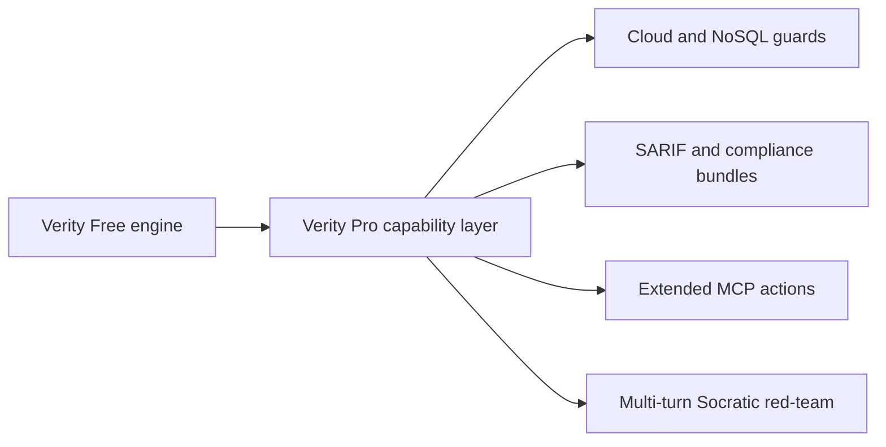
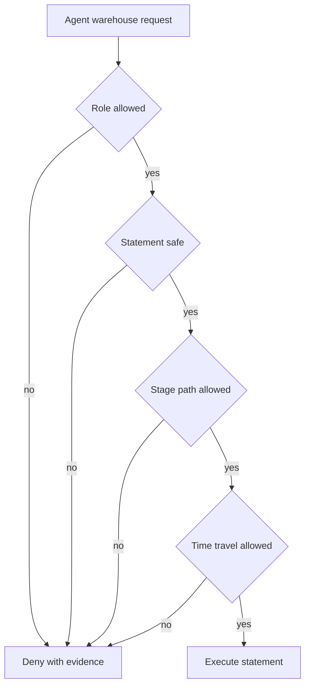
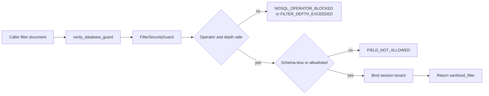
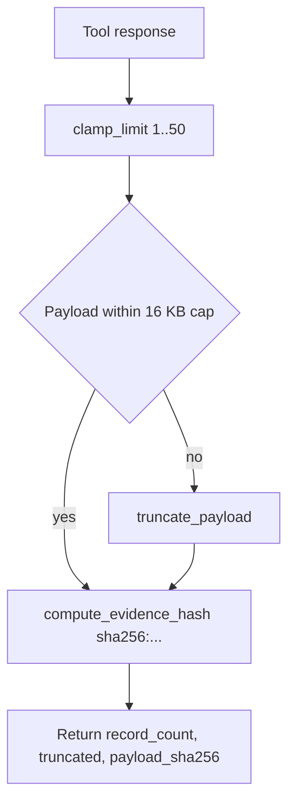
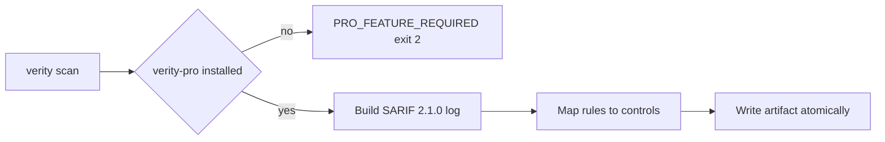
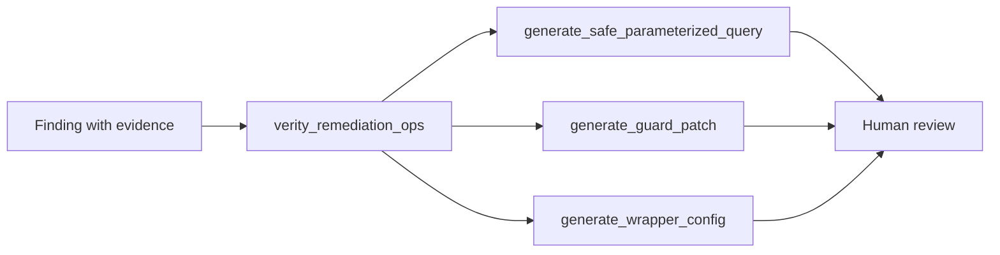
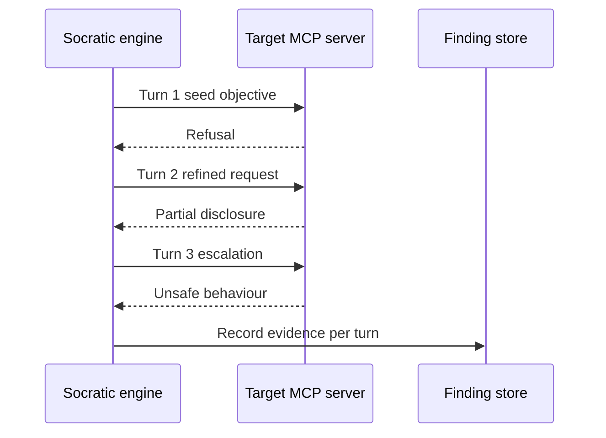

# Verity Pro Enterprise Features

Verity RedTeam Free is Apache-2.0 licensed and covers the Tier 1 and Tier 2
customer core: multi-dialect SQL AST guarding, MCP config discovery, static
metadata screening, Python AST source review, OSV correlation, and the
agent-native MCP server.

Verity RedTeam Pro is the commercial edition. It adds cloud warehouse and
NoSQL guards, OASIS SARIF v2.1.0 compliance export, an extended
`verity_remediation_ops` action set, and multi-turn Socratic red-teaming.

## Overview

Pro is installed as the `verity-pro` package alongside the Free engine. It
does not fork the Free analysis core, so rule IDs, evidence shapes, severity
thresholds, and exit-code semantics stay identical between editions. Pro only
adds capabilities that Free does not implement.

Every Pro capability is reachable from three entry points:

- **Python library** — guards in `verity.mcp_library` and reporting helpers.
- **CLI** — extra output formats and compliance bundles on existing commands.
- **Agent-native MCP server** — additional actions dispatched by `verity serve`.

| Capability | Package | Primary entry point |
| --- | --- | --- |
| Cloud warehouse guard | `verity-pro` | `SnowflakeSecurityGuard` |
| NoSQL filter guard | `verity-pro` | `FilterSecurityGuard` |
| Volume policy guard | `verity-pro` | `VolumePolicyGuard` |
| SARIF and compliance bundles | `verity-pro` | `verity scan --format sarif` |
| Extended remediation actions | `verity-pro` | `verity_remediation_ops` |
| Multi-turn Socratic red-teaming | `verity-pro` | `DiscoverySessionRunner` |

Pro capabilities fail closed. When the Free engine is asked for a Pro-only
capability it returns a structured `PRO_FEATURE_REQUIRED` error instead of
approximating the check. The full contract is documented in the final section.



## Free vs. Pro Feature Comparison

The matrix maps each customer-facing domain to Free and Pro behaviour. Every
Pro cell carries the `[Pro]` badge, and the Free column records exactly what an
Apache-2.0 installation can do today.

| Capability Domain | Verity RedTeam Free (Apache-2.0) | Verity RedTeam Pro (Commercial) |
| --- | --- | --- |
| Database AST Guarding | `SqlSecurityGuard` with seven SQL dialects | [Pro] Cloud warehouse and NoSQL suite (`SnowflakeSecurityGuard`, `FilterSecurityGuard`, `VolumePolicyGuard`) |
| Reporting & CI/CD Formats | `--format terminal`, `--format json`, `--format markdown`, `--format html` | [Pro] OASIS SARIF v2.1.0 (`--format sarif`) and multi-framework compliance bundles; Free returns `PRO_FEATURE_REQUIRED` with exit code 2 |
| Agent-Native MCP Server (verity serve) | Base four tools (`verity_security_scan`, `verity_database_guard`, `verity_database_oracle`, `verity_remediation_ops`) | [Pro] Unlocks `validate_role_assignment`, `validate_snowflake_query`, `validate_nosql_filter`, `enforce_volume_policy`, `export_sarif`, `generate_guard_patch`, `generate_wrapper_config`, `generate_safe_parameterized_query`, `check_canary_proof` |
| Adversarial Verification & Red-Teaming | Four zero-Docker `--demo` targets with single-turn probes | [Pro] Multi-turn Socratic red-teaming (`DiscoverySessionRunner` and `SocraticRefinementEngine`) with neurosymbolic remediation |

Badges are load-bearing. A `[Pro]` row never degrades quietly into a weaker
check: the Free engine answers with `PRO_FEATURE_REQUIRED` and exit code 2 so
that a CI gate cannot mistake a missing capability for a clean scan.

## Database Guards

Model-generated queries are the highest-impact MCP surface. An assistant that
can build SQL, filter documents, or page through results can also escape a
tenant, read a stage, or exfiltrate a warehouse. Free ships
`SqlSecurityGuard`, which parses statement text for seven dialects. Pro adds
three guards that understand the surrounding session: role, filter document,
and response volume.

### SnowflakeSecurityGuard

**Threat and purpose.** A warehouse role that is taken over — or simply minted
by an over-broad credential — can switch session roles, exfiltrate data via
`GET`/`PUT` or `COPY INTO @attacker_stage`, invoke `SYSTEM$*` or `INFER_SCHEMA`
administrative functions, cross database share boundaries, or time-travel via
`AT`/`BEFORE` clauses to recover deleted data. `SnowflakeSecurityGuard` parses
queries with `sqlglot` (`read="snowflake"`) AST inspection — allowing benign
single trailing semicolons and reserved words inside string literals while
blocking dangerous AST nodes — and enforces configurable allowlists loaded from
`.agents/policies.yaml` or `VERITY_SNOWFLAKE_POLICIES` via
`load_snowflake_policies()`.

**Free vs. Pro delta.** Free `SqlSecurityGuard` parses Snowflake SQL for
injection and unbounded reads but has no notion of session role, stage
allowlists, `SYSTEM$*`/`INFER_SCHEMA` blocking, database share boundaries, or
Time Travel AST offsets. Those checks exist only in `SnowflakeSecurityGuard`,
which is Pro-only.

```python
from verity.mcp_library.snowflake_guard import SnowflakeSecurityGuard, load_snowflake_policies

policies = load_snowflake_policies()  # reads VERITY_SNOWFLAKE_POLICIES or .agents/policies.yaml
guard = SnowflakeSecurityGuard(
    allowed_stages=policies.allowed_stages or ("@TRUSTED",),
    restricted_databases=policies.restricted_databases or ("HR_PAYROLL_DB",),
    allowed_databases=policies.allowed_databases or ("ANALYTICS_DB",),
)
guard.validate_session_role(role="ANALYST_READ_ROLE")
guard.validate_query(sql="SELECT id, total FROM orders WHERE tenant_id = :1;")
guard.validate_stage_path(path="@TRUSTED/orders/")
guard.validate_share_boundary("ANALYTICS_DB")
guard.validate_time_travel(clause="AT(OFFSET => -3600)")
```

```bash
verity test --sql "SELECT * FROM orders AT(OFFSET => -86400)" --dialect snowflake
```



### FilterSecurityGuard

**Threat and purpose.** An agent that passes a caller-supplied filter document
to MongoDB can inject operators such as `$ne`, `$where`, or `$gt`, exceed safe
nesting bounds, or forge `tenant_id` to widen a single-tenant read into a
cross-tenant dump. `FilterSecurityGuard` supports both **schema-less universal
mode** (`allowed_fields=None`, no implicit default allowlist — blocking
`$`-prefixed operators with `NOSQL_OPERATOR_BLOCKED` and nesting deeper than
`max_depth=3` with `FILTER_DEPTH_EXCEEDED` while always binding `tenant_id`) and
**explicit allowlist mode** (`allowed_fields={"customer_id", "status", "invoice_id"}`,
blocking unknown keys with `FIELD_NOT_ALLOWED`).

**Free vs. Pro delta.** Free ships no NoSQL parser: SQL AST guarding covers SQL
dialects only, and `verity_database_guard(action="validate_nosql_filter")`
fails closed with `PRO_FEATURE_REQUIRED` in Free before importing any guard
module. Dual-mode NoSQL filter inspection and tenant binding are Pro-only.

```python
from verity.mcp_library.filters import FilterSecurityGuard

universal_guard = FilterSecurityGuard()
universal_filter = universal_guard.validate_and_sanitize(
    filter_obj={"custom_field": "abc", "tenant_id": "spoofed"},
    session_tenant="tenant-a",
)

allowlist_guard = FilterSecurityGuard(
    allowed_fields={"customer_id", "status", "invoice_id"},
    session_tenant="tenant-a",
)
safe_filter = allowlist_guard.validate_and_sanitize(
    filter_obj={"status": "OPEN"},
    session_tenant="tenant-a",
)
```

```json
{
  "tool": "verity_database_guard",
  "arguments": {
    "action": "validate_nosql_filter",
    "options": {
      "filter_obj": {"customer_id": {"$ne": ""}},
      "session_tenant": "tenant-a"
    }
  }
}
```



### VolumePolicyGuard

**Threat and purpose.** A single unbounded read can stream an entire table into
a model context, blowing out token budgets and moving data the agent was never
meant to see. `VolumePolicyGuard` clamps `requested_limit` to
`1..VolumePolicyGuard.MAX_ALLOWED_LIMIT` (`50`), enforces a 16 KB
(`MAX_PAYLOAD_BYTES = 16384`) byte budget via `truncate_payload`, and emits a
tamper-evident `sha256:...` digest via `compute_evidence_hash` (exposed on
`verity_database_guard(action="enforce_volume_policy")` with `record_count`,
`truncated`, and `payload_sha256`).

**Free vs. Pro delta.** Free reports unbounded reads as findings and gates
`verity_database_guard(action="enforce_volume_policy")` with
`PRO_FEATURE_REQUIRED` (returning no records and keeping the MCP server live).
Limit clamping, payload truncation, and evidence hashing are Pro-only.

```python
from verity.mcp_library.volume import VolumePolicyGuard

guard = VolumePolicyGuard()
allowed_rows = guard.clamp_limit(requested_limit=50000)  # clamped to 1..50
records, truncated = guard.truncate_payload(records=[{"id": 1}, {"id": 2}])  # 16 KB cap
evidence_hash = guard.compute_evidence_hash(records=records)  # "sha256:..."
```

```json
{
  "tool": "verity_database_guard",
  "arguments": {
    "action": "enforce_volume_policy",
    "options": {
      "records": [{"id": 1}, {"id": 2}],
      "requested_limit": 50000
    }
  }
}
```



## Compliance & SARIF Reporting

Compliance teams need findings in the format their code-scanning dashboard
already ingests. Free prints JSON, Markdown, HTML, and terminal summaries.
Pro adds an OASIS SARIF v2.1.0 exporter and multi-framework compliance bundles
that map the same evidence onto external control sets.

### OASIS SARIF v2.1.0 & Compliance Bundles

**Threat and purpose.** Security review stalls when MCP findings live only in a
terminal scrollback. An attacker benefits from every finding that never reaches
a tracked dashboard. The exporter turns each finding into a stable SARIF result
with rule metadata, locations, and remediation text so it can be uploaded,
deduplicated, and triaged.

**Free vs. Pro delta.** In Free, `--format sarif` fails closed: the engine emits the deterministic `PRO_FEATURE_REQUIRED` JSON payload (`"ok": false`, `"verdict": "PRO_REQUIRED"`, `"error": "PRO_FEATURE_REQUIRED"`), exits with code 2, and writes zero partial files even when `--output` is supplied. When `verity-pro` is installed, `--format sarif` and `ComplianceReportEngine.generate_bundle()` preserve exact `physicalLocation.region.startLine` (falling back to `startLine: 1` when line info is absent) and `artifactLocation.uri`, write the SARIF artifact atomically, and place OSV v1.6.0 `AIVSS` metrics under `database_specific.aivss` (keeping `CVSS_V3` in top-level `severity[]`).

```python
from verity_pro.reporting.sarif import SarifExporter

exporter = SarifExporter(tool_version="2.1.0")
artifact = exporter.export(findings=findings)
exporter.write(artifact, path="verity-results.sarif")
```

```bash
verity scan --path . --format sarif --output verity-results.sarif --fail-on-findings
```



## Agent-Native MCP Server Actions

The Free `verity serve` surface exposes four tools — `verity_security_scan`,
`verity_database_guard`, `verity_database_oracle`, and
`verity_remediation_ops` — so an assistant can run scans, validate SQL, compare
vulnerable and patched behaviour, and request fixes.

Pro unlocks additional actions inside the same dispatcher. The base four tools
keep their names and schemas; the extra actions are reached through the guard
and remediation tools rather than new transport endpoints.

| Pro action | Dispatched from | Purpose |
| --- | --- | --- |
| `validate_role_assignment` | `verity_database_guard` | Check warehouse role grants before execution. |
| `validate_snowflake_query` | `verity_database_guard` | Full Snowflake role, stage, and time-travel review. |
| `validate_nosql_filter` | `verity_database_guard` | Parse and tenant-bind document filters. |
| `enforce_volume_policy` | `verity_database_guard` | Clamp rows and bytes on tool responses. |
| `export_sarif` | `verity_security_scan` | Emit OASIS SARIF v2.1.0 for the current findings. |
| `generate_safe_parameterized_query` | `verity_remediation_ops` | Rewrite a vulnerable statement with bind parameters. |
| `generate_guard_patch` | `verity_remediation_ops` | Produce a minimal guard insertion patch. |
| `generate_wrapper_config` | `verity_remediation_ops` | Produce hardening config for the failing client. |
| `check_canary_proof` | `verity_database_oracle` | Verify that a canary proves the fix holds. |

```bash
verity serve --transport stdio
```

## Remediation

Findings only reduce risk when the fix is concrete. Free returns prioritised
remediation text with rule IDs, evidence, and file locations. Pro adds
machine-applicable remediation actions that turn a finding into a patch an
assistant can review and apply.

### Pro verity_remediation_ops

**Threat and purpose.** A team that reads a finding but cannot apply a fix
leaves the vulnerable tool deployed. The Pro action set generates a safe
parameterized query, a guard patch, and a wrapper configuration so the
vulnerable path is closed rather than merely reported.

**Free vs. Pro delta.** Free `verity_remediation_ops` returns advisory text
only. The three generative actions below are Pro-only; on Free each one returns
`PRO_FEATURE_REQUIRED` with exit code 2, and no partial patch is written.

```python
from verity.mcp_server.tools import VerityToolDispatcher

dispatcher = VerityToolDispatcher(context=None)

result = dispatcher.execute_tool(
    "verity_remediation_ops",
    {
        "action": "generate_safe_parameterized_query",
        "dialect": "postgres",
        "statement": "SELECT id, total FROM invoices WHERE tenant_id = $1",
    },
)
```

```json
{
  "tool": "verity_remediation_ops",
  "arguments": {
    "action": "generate_guard_patch",
    "target_file": "agent/tools.py",
    "rule_id": "VERITY-STATIC-SQL-INJECTION-SCHEMA"
  }
}
```



## Adversarial Verification & Red-Teaming

Static rules catch patterns; adversarial verification proves whether a server
actually misbehaves when pushed. Free includes four zero-Docker demo targets
and single-turn probes that confirm SQL injection, BOLA, NoSQL operator
injection, and unsafe execution in-process.

### Multi-Turn Socratic Red-Teaming

**Threat and purpose.** Real attackers do not stop at the first refusal. They
rephrase, split a request across turns, and probe for unadvertised side
effects. Multi-turn Socratic red-teaming drives a target through escalating
conversational refinements and records which turn produced the unsafe
behaviour, so a refusal that only holds for one phrasing is not mistaken for a
control.

**Free vs. Pro delta.** Free runs single-turn probes against the demo targets.
Session orchestration, refusal-aware refinement, and neurosymbolic remediation
advice are Pro-only, and each Pro entry point fails closed with
`PRO_FEATURE_REQUIRED` on Free.

```python
from verity_pro.redteam.socratic import DiscoverySessionRunner, SocraticRefinementEngine

runner = DiscoverySessionRunner(
    target_profile="mcp-http",
    refusal_policy="non-destructive",
    max_turns=6,
)

engine = SocraticRefinementEngine(runner=runner)
session = engine.run(seed_objective="map unadvertised tool side effects")
```

```json
{
  "tool": "verity_security_scan",
  "arguments": {
    "action": "redteam_session",
    "target": "http://localhost:3000/sse",
    "max_turns": 6,
    "refusal_policy": "non-destructive"
  }
}
```



## Graceful Degradation (PRO_FEATURE_REQUIRED)

Pro capability requests never produce a silent downgrade. Whenever the Free
engine is asked for a Pro-only capability it returns exactly one structured
error and performs no work:

```json
{"error": "PRO_FEATURE_REQUIRED", "feature": "<feature>", "message": "<message>"}
```

The contract has four guarantees:

- **CLI exit code 2.** A Pro-only command exits 2, distinct from the finding
  threshold exit code 1, so a pipeline can tell "capability missing" apart from
  "vulnerable".
- **No partial writes.** Verity never writes a partial or empty output file. If
  `--output` was supplied, the target path is left untouched, so a stale
  artifact cannot be mistaken for a fresh one.
- **No unhandled traceback.** The failure is reported as the structured error
  above, never as an unhandled traceback.
- **MCP calls stay live.** A Pro-only MCP action returns the same structured
  error object inside the tool result, and the server keeps serving subsequent
  requests.

| Feature | Free behavior | Pro behavior |
| --- | --- | --- |
| `SnowflakeSecurityGuard` | `PRO_FEATURE_REQUIRED`, exit code 2 | Role, stage, and time-travel enforcement |
| `FilterSecurityGuard` | `PRO_FEATURE_REQUIRED`, exit code 2 | NoSQL operator and tenant enforcement |
| `VolumePolicyGuard` | `PRO_FEATURE_REQUIRED`, exit code 2 | Row and byte caps with evidence hashing |
| SARIF and compliance bundles | `PRO_FEATURE_REQUIRED`, exit code 2, no output file | OASIS SARIF v2.1.0 plus compliance bundles |
| Generative `verity_remediation_ops` actions | `PRO_FEATURE_REQUIRED`, exit code 2 | Safe query, guard patch, wrapper config |
| Multi-turn Socratic red-teaming | `PRO_FEATURE_REQUIRED`, exit code 2 | Multi-turn discovery, refinement, remediation |

Installing `verity-pro` is the only unlock. No environment variable, no
configuration flag, and no CLI switch enables Pro behaviour in Free.
