# Milestone Roadmap (M01-M38)

This roadmap is generated from `TASK_BOARD.md` by
`scripts/build_docs_portal.py`. It reflects the shipped milestones,
the active backlog, and the exact project item backing each task.

## Executive Overview

Verity Red Team evolved in four arcs. The first arc produced a
standalone, stdlib-only MCP server and a zero-Docker workstation
scanner — the minimum viable product that proves value in seconds.
The second arc hardened the open-core boundary, shipped the free CLI,
and published `0.2.0` to PyPI. The third arc closed every parity gap
that a customer could hit in the field: offline mode, SSE transport,
rug-pull detection, credential shapes, dialect-aware SQL guards, and
container-verified end-to-end scenarios. The fourth arc turns the
entire engineering record into a published documentation portal so
adoption no longer depends on reading the source tree.

The invariant across all four arcs is the runtime abstraction
barrier: core never imports enterprise code, and enterprise
capabilities register through the `verity.plugins` entry point.
Every milestone below respects that boundary, which is why the
free distribution stays small and auditable while the commercial
edition can layer additional detectors on top.

### Architectural Evolution

The roadmap reads as a sequence of separations of concerns, each of
which removed a class of coupling that would otherwise have blocked
the next phase.

1. **Runtime separation (M01-M06).** The plugin contract, the MCP
   server, the static screen, and the SQL AST guard were split into
   independently testable units behind typed dataclasses.
2. **Distribution separation (M07-M11).** The CLI surface, the
   zero-dependency packaging, and the PyPI release decoupled the
   engine from any particular checkout or container runtime.
3. **Environment separation (M12-M37).** Transports, offline mode,
   credential handling, and dialect awareness removed assumptions
   about network access, secret storage, and database vendor.
4. **Knowledge separation (M38).** The documentation portal and the
   task-to-docs pipeline decouple what the engine does from how a
   customer learns about it.

## Capability Evolution

```mermaid
flowchart LR
    subgraph P1["Foundation (M01-M06)"]
        F1["Plugin Core & MCP Server"]
        F2["Discovery & Static Screening"]
        F3["SQL AST Guard"]
        F4["uv Workspace Linkage"]
        F5["Free CLI & 4 Targets"]
        F6["CI/CD Readiness"]
    end
    subgraph P2["Open-Core Engine (M07-M11)"]
        E1["CLI Parity & Auditor Wiring"]
        E2["Empty-Container E2E"]
        E3["VHS Demo GIF"]
        E4["Customer README"]
        E5["v0.2.0 PyPI Release"]
    end
    subgraph P3["Hardening & Parity (M12-M37)"]
        H1["SSE & Streamable HTTP"]
        H2["Rug-Pull & Offline Mode"]
        H3["Credential & Dialect Hardening"]
        H4["Governance & Nightly E2E"]
    end
    subgraph P4["Documentation Portal (M38)"]
        D1["MkDocs Portal"]
        D2["Task-to-Docs Pipeline"]
    end
    P1 --> P2 --> P3 --> P4
```

## Phase Breakdown

### Phase 1 — Foundation (M01-M06)

Standalone core, deterministic static screening, SQL AST guard, workspace linkage, free CLI, and CI readiness.

| Milestone | Title | Status | Focus |
| --- | --- | --- | --- |
| M01 | Plugin Foundation & Core MCP Server | Done | Plugin protocols, entry points, stdlib JSON-RPC MCP server |
| M02 | Workstation Discovery & Static Screening | Done | 9-client scanner, 13-rule StaticRuleEvaluator, fingerprinting, OSV cache |
| M03 | Deterministic SQL AST Guard | Done | Cohesive 245-line `SqlSecurityGuard` (`sqlglot`), Pro Snowflake guard |
| M04 | Link `verity-pro` to `verity-core` via `uv` Workspace | Done | `[tool.uv.sources]`, `src/verity_pro/` packaging, remove duplicated core |
| M05 | Net-New Free CLI & 4 In-Memory Synthetic Targets | Done | `verity scan`, `test --demo`, `serve`, Rich tables, 4 zero-Docker targets |
| M06 | CI/CD & Launch Readiness | Done | Multi-platform GitHub Actions matrix, `uv build` wheel, Pro regression |

### Phase 2 — v0.2.0 Open-Core Engine (M07-M11)

Parity fixes, ground-zero container verification, reproducible demo media, customer documentation, and the PyPI release.

| Milestone | Title | Status | Focus |
| --- | --- | --- | --- |
| M07 | CLI Parity, `ConsolidatedSecurityAuditor` Wiring & YAML Config Support | Done | Wire secret scrubbing, shell wrappers, OSV CVEs & YAML parsing into `verity scan` |
| M08 | Ground-Zero Empty-Container E2E Customer Verification Suite | Done | Clean-room Docker matrix (`wheel`/`pypi`), real + fixture MCP targets, 6 scenarios |
| M09 | Dynamic, Narrow Terminal Screencast GIF (Charmbracelet VHS in Docker) | Done | Reproducible VHS `.tape` (`~860x440`), 4 live scenes, `gifsicle`-optimized `demo.gif` |
| M10 | Customer-Focused `README.md` Restructure & CLI Documentation Parity Test | Done | Pain-point-first README with container-verified outputs, `demo.gif`, CI parity test |
| M11 | Credential Detection Hardening, Packaging/Display Polish & `v0.2.0` PyPI Release | Done | DSN & value-pattern secret checks, SPDX license, `Rule` `no_wrap=True`, `v0.2.0` publish + live PyPI E2E |

### Phase 3 — Hardening & Parity (M12-M37)

Transport, detection, offline, credential, dialect, governance, and distribution hardening driven by real customer scenarios.

| Milestone | Title | Status | Focus |
| --- | --- | --- | --- |
| M12 | Real Streaming SSE (`text/event-stream`) & Streamable HTTP Transport Support | Done | Incremental SSE frame parser, Streamable HTTP `mcp-session-id`, legacy SSE endpoint, unit tests & real `FastMCP` E2E |
| M13 | Expose UCP Rug-Pull Detection (`detect_rug_pull`) in `verity_security_scan` & CLI | Done | `detect_rug_pull` MCP action, `verity test --save-baseline`/`--baseline`, unit tests & mutable server E2E |
| M14 | True End-to-End `VERITY_OFFLINE` & Air-Gapped Cold-Start Baseline Support | Done | Zero-socket `VERITY_OFFLINE` across `data_fetcher`/matchers, expired-cache/baseline, unit tests & `--network none` E2E |
| M15 | Flag Unpinned MCP Packages (`SEC-STATIC-UNPINNED-PACKAGE`) Instead of Guessing Latest Version | Done | Return `None` for unpinned version, emit `SEC-STATIC-UNPINNED-PACKAGE`, unit tests & real `mcp-remote` E2E |
| M16 | Detect AWS `AKIA…` Keys, PEM Private Keys & Cloud Tokens in MCP Config Values | Done | Shared credential pattern registry, extended key names, full scrubbing, unit tests & container E2E |
| M17 | Dialect-Aware `SqlSecurityGuard` (`--dialect` CLI & `verity_database_guard` Support) | Done | Pass `read=dialect` (default `postgres`), expose `--dialect` on `verity test --sql` & `verity_database_guard`, unit tests & SQLite/MySQL E2E |
| M18 | Sync SARIF Exporter Driver Version with `verity.__version__` | Done | Replace hardcoded `"0.1.0"` in `_stdlib_sarif_exporter` with `verity.__version__`, unit tests & container SARIF E2E |
| M19 | Opt-In `--live-probe` Flag on `verity scan` for Fleet-Wide Live Capability Auditing | Done | Expose `--live-probe` on `verity scan`, thread into `auditor.audit_server()`, isolate dead servers, unit tests & container E2E |
| M20 | Add `README.md` Hero Badge Row (PyPI, License, Python 3.12+, CI) & Parity Guard | Done | Add 4-badge Hero row above tagline in `README.md`, doc parity guard & wheel metadata container check |
| M21 | Sync `README.md` Verbatim Tables, `demo.tape` Scene 4 & `demo.gif` to `v0.2.0` Un-Ellipsized Output | Done | Sync two ellipsized README tables to snapshots `01`/`02`, run full `verity test --demo` in Scene 4, re-record `demo.gif` & parity tests |
| M22 | Publish GitHub Release for `v0.2.0` & Guard Duplicate PyPI Workflow Trigger | Done | Guard `.github/workflows/workflow.yaml` duplicate PyPI upload, publish `v0.2.0` GitHub Release notes, workflow unit test & PyPI E2E |
| M23 | Remove Stale "If the package is not yet on PyPI…" Caveat from `README.md` | Done | Make PyPI primary install path, move source build into `
`, add parity test & cold PyPI container check |
| M24 | Extend Container E2E (`verify_all_scenarios.sh`) for DSN Credentials, `CUSTOM_FIELD=sk-…` & Live DVMCP `stdio` Probing | Done | Add `DATABASE_URL` DSN + safe twin, `CUSTOM_FIELD=sk-…` leak assertions, and live DVMCP `verity test --command` probing |
| M25 | Add Nightly `schedule` Trigger (`cron: '0 4 * * *'`) to `e2e-containers.yml` | Done | Add nightly `0 4 * * *` cron trigger to `e2e-containers.yml` and workflow hygiene unit test |
| M26 | Upgrade `actions/checkout` and `astral-sh/setup-uv` Pins Across All GitHub Actions Workflows | Done | Upgrade `actions/checkout` and `astral-sh/setup-uv` to Node-24-ready versions across all 4 workflows + unit test |
| M27 | Guard `uv build` & Local Wheel Staging in `run_e2e.sh` When `INSTALL_SOURCE=pypi` | Done | Guard `uv build` behind `INSTALL_SOURCE=wheel`, clean stale wheels, unit test & dual-mode container E2E |
| M28 | Fix Retired `verity-core` Package Name in `AGENTS.md` & Extend Documentation Parity Guard | Done | Replace `verity-core` with `verity-redteam-core` in `AGENTS.md` and extend `test_no_stale_package_references` |
| M29 | Populate Exact GitHub Project #5 Item IDs & Links Across `TASK_BOARD.md` (`M1`–`M29`) | Done | Harvest `PVTI_…` item IDs via `gh project item-list 5`, backfill `M1`–`M11` rows/sections, add dynamic parity guard |
| M30 | `uvx` Single-Token Execution & Homebrew Distribution (`TASK-79`) | Ready | Dual `verity-redteam-core` script entrypoint, `-V`/`--version`, `[project.urls]`, `generate_homebrew_formula.py`, `JMartynov/homebrew-tap` |
| M31 | CLI CI Prerequisites & Brownfield Baseline / Ignore Engine (`TASK-80`) | Ready | Stdlib `verity.baseline` (`paths`, `fingerprint`, `ignore`, `inline`, `store`), `--fail-on-severity`, multi-file `--path`, un-gated Core SARIF 2.1.0 |
| M32 | Official GitHub Action (`verity-scan-action@v1`) & Pre-Commit Hooks (`TASK-81`) | Ready | `.pre-commit-hooks.yaml` (`verity-scan`, `verity-scan-configs`, `verity-scan-uvx`), README snippet, `JMartynov/verity-scan-action` |
| M33 | TypeScript / JavaScript MCP SAST Scanner (`TASK-90`) | Ready | Polyglot `.ts`/`.tsx`/`.js`/`.mjs` discovery in `McpAstScannerEngine`, `typescript_ast.py`, 5 `VERITY-AST-TS-*` sink rules, UCP/StaticRule wiring |
| M34 | Agent Skill / Instruction File Scanner & Cross-Tool Toxic Flow Analysis (`TASK-91`) | Ready | `InstructionFileScanner` (6 formats), `ToxicFlowAnalyzer` lethal-trifecta correlation (`VERITY-TOXIC-FLOW-*`), `--skills` / `--toxic-flows` |
| M35 | Authenticated Remote Probing (OAuth/Bearer) & `--identify-as` Bait-and-Switch Detection (`TASK-92`) | Ready | `DiscoveredServerConfig.headers` (redacted), `--header`/`--bearer-token`, `--identify-as`, differential `--detect-bait-and-switch` |
| M36 | ANSI Terminal Deception & Unicode BiDi/Tag-Char Findings (`TASK-93`) | Ready | Explicit ANSI/BiDi/Tag/zero-width `StaticRuleEvaluator` rules, `VERITY-UCP-UNICODE-ANOMALY` wiring, `--visualize-ansi-codes` |
| M37 | MCP Schema-Handler Drift & Structured Agent Guidance (`TASK-85`) | Ready | Expose `verify_physical_database` / `generate_safe_parameterized_query` in `schemas.py`, `DualPathRouter` + `next_recommended_actions`, `--unified-only` |

### Phase 4 — Customer Documentation Portal (M38)

MkDocs Material portal plus the automated task-to-docs pipeline.

| Milestone | Title | Status | Focus |
| --- | --- | --- | --- |
| M38 | Web Documentation Portal & Automated Task-to-Docs Pipeline (`TASK-94`) | Done | MkDocs Material portal (`mkdocs.yml`), 10 deep guides/catalogs, `scripts/build_docs_portal.py`, GitHub Pages workflow |

## Milestone Table (M01-M38)

| # | Title | Phase | Status | Project Item | Spec |
| --- | --- | --- | --- | --- | --- |
| M01 | Plugin Foundation & Core MCP Server | Foundation | Done | `PVTI_lAHOD-xmQM4Br351zhJQ99Q` | [TASK_BOARD.md](https://github.com/JMartynov/verityredteam-free/blob/main/TASK_BOARD.md) |
| M02 | Workstation Discovery & Static Screening | Foundation | Done | `PVTI_lAHOD-xmQM4Br351zhJQ-AE` | [TASK_BOARD.md](https://github.com/JMartynov/verityredteam-free/blob/main/TASK_BOARD.md) |
| M03 | Deterministic SQL AST Guard | Foundation | Done | `PVTI_lAHOD-xmQM4Br351zhJQ-DA` | [TASK_BOARD.md](https://github.com/JMartynov/verityredteam-free/blob/main/TASK_BOARD.md) |
| M04 | Link `verity-pro` to `verity-core` via `uv` Workspace | Foundation | Done | `PVTI_lAHOD-xmQM4Br351zhJQ-Gg` | [TASK_BOARD.md](https://github.com/JMartynov/verityredteam-free/blob/main/TASK_BOARD.md) |
| M05 | Net-New Free CLI & 4 In-Memory Synthetic Targets | Foundation | Done | `PVTI_lAHOD-xmQM4Br351zhJQ-I8` | [TASK_BOARD.md](https://github.com/JMartynov/verityredteam-free/blob/main/TASK_BOARD.md) |
| M06 | CI/CD & Launch Readiness | Foundation | Done | `PVTI_lAHOD-xmQM4Br351zhJQ-Mo` | [TASK_BOARD.md](https://github.com/JMartynov/verityredteam-free/blob/main/TASK_BOARD.md) |
| M07 | CLI Parity, `ConsolidatedSecurityAuditor` Wiring & YAML Config Support | v0.2.0 Open-Core Engine | Done | `PVTI_lAHOD-xmQM4Br351zhKMCKw` | [M7_cli_parity_and_auditor_wiring.md](../tasks/M7_cli_parity_and_auditor_wiring.md) |
| M08 | Ground-Zero Empty-Container E2E Customer Verification Suite | v0.2.0 Open-Core Engine | Done | `PVTI_lAHOD-xmQM4Br351zhKMCQA` | [M8_empty_container_e2e_verification.md](../tasks/M8_empty_container_e2e_verification.md) |
| M09 | Dynamic, Narrow Terminal Screencast GIF (Charmbracelet VHS in Docker) | v0.2.0 Open-Core Engine | Done | `PVTI_lAHOD-xmQM4Br351zhKMCU4` | [M9_dynamic_narrow_demo_gif.md](../tasks/M9_dynamic_narrow_demo_gif.md) |
| M10 | Customer-Focused `README.md` Restructure & CLI Documentation Parity Test | v0.2.0 Open-Core Engine | Done | `PVTI_lAHOD-xmQM4Br351zhKMCYw` | [M10_customer_readme_restructure_and_parity.md](../tasks/M10_customer_readme_restructure_and_parity.md) |
| M11 | Credential Detection Hardening, Packaging/Display Polish & `v0.2.0` PyPI Release | v0.2.0 Open-Core Engine | Done | `PVTI_lAHOD-xmQM4Br351zhKNnNg` | [M11_credential_hardening_polish_and_v020_release.md](../tasks/M11_credential_hardening_polish_and_v020_release.md) |
| M12 | Real Streaming SSE (`text/event-stream`) & Streamable HTTP Transport Support | Hardening & Parity | Done | `PVTI_lAHOD-xmQM4Br351zhKPNQ0` | [M12_streaming_sse_streamable_http_transport.md](../tasks/M12_streaming_sse_streamable_http_transport.md) |
| M13 | Expose UCP Rug-Pull Detection (`detect_rug_pull`) in `verity_security_scan` & CLI | Hardening & Parity | Done | `PVTI_lAHOD-xmQM4Br351zhKPQE0` | [M13_expose_ucp_rug_pull_detection.md](../tasks/M13_expose_ucp_rug_pull_detection.md) |
| M14 | True End-to-End `VERITY_OFFLINE` & Air-Gapped Cold-Start Baseline Support | Hardening & Parity | Done | `PVTI_lAHOD-xmQM4Br351zhKPSWU` | [M14_true_offline_airgapped_mode.md](../tasks/M14_true_offline_airgapped_mode.md) |
| M15 | Flag Unpinned MCP Packages (`SEC-STATIC-UNPINNED-PACKAGE`) Instead of Guessing Latest Version | Hardening & Parity | Done | `PVTI_lAHOD-xmQM4Br351zhKPUAU` | [M15_unpinned_mcp_package_detection.md](../tasks/M15_unpinned_mcp_package_detection.md) |
| M16 | Detect AWS `AKIA…` Keys, PEM Private Keys & Cloud Tokens in MCP Config Values | Hardening & Parity | Done | `PVTI_lAHOD-xmQM4Br351zhKPito` | [M16_cloud_credential_pattern_detection.md](../tasks/M16_cloud_credential_pattern_detection.md) |
| M17 | Dialect-Aware `SqlSecurityGuard` (`--dialect` CLI & `verity_database_guard` Support) | Hardening & Parity | Done | `PVTI_lAHOD-xmQM4Br351zhKQV5Y` | [M17_dialect_aware_sql_security_guard.md](../tasks/M17_dialect_aware_sql_security_guard.md) |
| M18 | Sync SARIF Exporter Driver Version with `verity.__version__` | Hardening & Parity | Done | `PVTI_lAHOD-xmQM4Br351zhKQWdQ` | [M18_sarif_driver_version_sync.md](../tasks/M18_sarif_driver_version_sync.md) |
| M19 | Opt-In `--live-probe` Flag on `verity scan` for Fleet-Wide Live Capability Auditing | Hardening & Parity | Done | `PVTI_lAHOD-xmQM4Br351zhKQWho` | [M19_scan_live_probe_flag.md](../tasks/M19_scan_live_probe_flag.md) |
| M20 | Add `README.md` Hero Badge Row (PyPI, License, Python 3.12+, CI) & Parity Guard | Hardening & Parity | Done | `PVTI_lAHOD-xmQM4Br351zhKQWlY` | [M20_readme_hero_badges.md](../tasks/M20_readme_hero_badges.md) |
| M21 | Sync `README.md` Verbatim Tables, `demo.tape` Scene 4 & `demo.gif` to `v0.2.0` Un-Ellipsized Output | Hardening & Parity | Done | `PVTI_lAHOD-xmQM4Br351zhKQWqY` | [M21_sync_demo_gif_and_readme_tables.md](../tasks/M21_sync_demo_gif_and_readme_tables.md) |
| M22 | Publish GitHub Release for `v0.2.0` & Guard Duplicate PyPI Workflow Trigger | Hardening & Parity | Done | `PVTI_lAHOD-xmQM4Br351zhKQWuQ` | [M22_github_release_v020_and_workflow_guard.md](../tasks/M22_github_release_v020_and_workflow_guard.md) |
| M23 | Remove Stale "If the package is not yet on PyPI…" Caveat from `README.md` | Hardening & Parity | Done | `PVTI_lAHOD-xmQM4Br351zhKQWx4` | [M23_remove_stale_pypi_caveat.md](../tasks/M23_remove_stale_pypi_caveat.md) |
| M24 | Extend Container E2E (`verify_all_scenarios.sh`) for DSN Credentials, `CUSTOM_FIELD=sk-…` & Live DVMCP `stdio` Probing | Hardening & Parity | Done | `PVTI_lAHOD-xmQM4Br351zhKQW1E` | [M24_container_e2e_dsn_and_live_dvmcp.md](../tasks/M24_container_e2e_dsn_and_live_dvmcp.md) |
| M25 | Add Nightly `schedule` Trigger (`cron: '0 4 * * *'`) to `e2e-containers.yml` | Hardening & Parity | Done | `PVTI_lAHOD-xmQM4Br351zhKQW4w` | [M25_nightly_e2e_containers_cron.md](../tasks/M25_nightly_e2e_containers_cron.md) |
| M26 | Upgrade `actions/checkout` and `astral-sh/setup-uv` Pins Across All GitHub Actions Workflows | Hardening & Parity | Done | `PVTI_lAHOD-xmQM4Br351zhKQW9A` | [M26_upgrade_github_actions_pins.md](../tasks/M26_upgrade_github_actions_pins.md) |
| M27 | Guard `uv build` & Local Wheel Staging in `run_e2e.sh` When `INSTALL_SOURCE=pypi` | Hardening & Parity | Done | `PVTI_lAHOD-xmQM4Br351zhKQXBQ` | [M27_guard_uv_build_in_run_e2e.md](../tasks/M27_guard_uv_build_in_run_e2e.md) |
| M28 | Fix Retired `verity-core` Package Name in `AGENTS.md` & Extend Documentation Parity Guard | Hardening & Parity | Done | `PVTI_lAHOD-xmQM4Br351zhKQXFA` | [M28_fix_agents_md_retired_package_name.md](../tasks/M28_fix_agents_md_retired_package_name.md) |
| M29 | Populate Exact GitHub Project #5 Item IDs & Links Across `TASK_BOARD.md` (`M1`–`M29`) | Hardening & Parity | Done | `PVTI_lAHOD-xmQM4Br351zhKQXJA` | [M29_exact_task_board_project_links.md](../tasks/M29_exact_task_board_project_links.md) |
| M30 | `uvx` Single-Token Execution & Homebrew Distribution (`TASK-79`) | Hardening & Parity | Ready | `PVTI_lAHOD-xmQM4Br351zhLJPUU` | [TASK_BOARD.md](https://github.com/JMartynov/verityredteam-free/blob/main/TASK_BOARD.md) |
| M31 | CLI CI Prerequisites & Brownfield Baseline / Ignore Engine (`TASK-80`) | Hardening & Parity | Ready | `PVTI_lAHOD-xmQM4Br351zhLJPYA` | [TASK_BOARD.md](https://github.com/JMartynov/verityredteam-free/blob/main/TASK_BOARD.md) |
| M32 | Official GitHub Action (`verity-scan-action@v1`) & Pre-Commit Hooks (`TASK-81`) | Hardening & Parity | Ready | `PVTI_lAHOD-xmQM4Br351zhLJPcI` | [TASK_BOARD.md](https://github.com/JMartynov/verityredteam-free/blob/main/TASK_BOARD.md) |
| M33 | TypeScript / JavaScript MCP SAST Scanner (`TASK-90`) | Hardening & Parity | Ready | `PVTI_lAHOD-xmQM4Br351zhLJPfA` | [TASK_BOARD.md](https://github.com/JMartynov/verityredteam-free/blob/main/TASK_BOARD.md) |
| M34 | Agent Skill / Instruction File Scanner & Cross-Tool Toxic Flow Analysis (`TASK-91`) | Hardening & Parity | Ready | `PVTI_lAHOD-xmQM4Br351zhLJPjE` | [TASK_BOARD.md](https://github.com/JMartynov/verityredteam-free/blob/main/TASK_BOARD.md) |
| M35 | Authenticated Remote Probing (OAuth/Bearer) & `--identify-as` Bait-and-Switch Detection (`TASK-92`) | Hardening & Parity | Ready | `PVTI_lAHOD-xmQM4Br351zhLJPm8` | [TASK_BOARD.md](https://github.com/JMartynov/verityredteam-free/blob/main/TASK_BOARD.md) |
| M36 | ANSI Terminal Deception & Unicode BiDi/Tag-Char Findings (`TASK-93`) | Hardening & Parity | Ready | `PVTI_lAHOD-xmQM4Br351zhLJPrY` | [TASK_BOARD.md](https://github.com/JMartynov/verityredteam-free/blob/main/TASK_BOARD.md) |
| M37 | MCP Schema-Handler Drift & Structured Agent Guidance (`TASK-85`) | Hardening & Parity | Ready | `PVTI_lAHOD-xmQM4Br351zhLJPuo` | [TASK_BOARD.md](https://github.com/JMartynov/verityredteam-free/blob/main/TASK_BOARD.md) |
| M38 | Web Documentation Portal & Automated Task-to-Docs Pipeline (`TASK-94`) | Customer Documentation Portal | Done | `PVTI_lAHOD-xmQM4Br351zhLOM2U` | [M38_web_documentation_portal_and_task_publisher.md](../tasks/M38_web_documentation_portal_and_task_publisher.md) |
| M39 | Python AST Real-World Rules & Import Aliases (`TASK-102`) | Future | Ready | `PVTI_lAHOD-xmQM4Br351zhLvl0M` | [M39_TASK_102_PYTHON_AST_REAL_WORLD_RULES_AND_IMPORT_ALIASES.md](../tasks/M39_TASK_102_PYTHON_AST_REAL_WORLD_RULES_AND_IMPORT_ALIASES.md) |
| M40 | Free CLI SARIF Pro Gate & Line Precision (`TASK-103-FREE`) | Future | Done | `PVTI_lAHOD-xmQM4Br351zhLvmAQ` | [M40_TASK_103_FREE_CLI_SARIF_PRO_GATE_AND_LINE_PRECISION.md](../tasks/M40_TASK_103_FREE_CLI_SARIF_PRO_GATE_AND_LINE_PRECISION.md) |
| M41 | Homepage Tier 1/2 Focus & Registry Parity (`TASK-104`) | Future | Done | `PVTI_lAHOD-xmQM4Br351zhLvmDo` | [M41_TASK_104_HOMEPAGE_TIER1_2_FOCUS_AND_REGISTRY_PARITY.md](../tasks/M41_TASK_104_HOMEPAGE_TIER1_2_FOCUS_AND_REGISTRY_PARITY.md) |
| M42 | Pro Features Showcase & Comparison Docs in Free (`TASK-107`) | Future | Done | `PVTI_lAHOD-xmQM4Br351zhLvmsE` | [M42_TASK_107_PRO_FEATURES_SHOWCASE_AND_COMPARISON_DOCS_IN_FREE.md](../tasks/M42_TASK_107_PRO_FEATURES_SHOWCASE_AND_COMPARISON_DOCS_IN_FREE.md) |
| M43 | Free MCP Database Guard Pro Gating (`TASK-109-FREE`) | Future | Ready | `PVTI_lAHOD-xmQM4Br351zhLvm_M` | [M43_TASK_109_FREE_MCP_DATABASE_GUARD_PRO_GATING.md](../tasks/M43_TASK_109_FREE_MCP_DATABASE_GUARD_PRO_GATING.md) |
| M44 | Free Read-Only Guard & Router Decoupling (`TASK-106-FREE`) | Future | Done | `PVTI_lAHOD-xmQM4Br351zhLvmgk` | [M44_TASK_106_FREE_READONLY_GUARD_AND_ROUTER_DECOUPLING.md](../tasks/M44_TASK_106_FREE_READONLY_GUARD_AND_ROUTER_DECOUPLING.md) |
| M45 | Free README Tier 1/2 Focus, Pro Showcase & Parity (`TASK-110-FREE`) | Future | Done | `PVTI_lAHOD-xmQM4Br351zhLvnMQ` | [M45_TASK_110_FREE_README_TIER1_2_FOCUS_PRO_SHOWCASE_AND_PARITY.md](../tasks/M45_TASK_110_FREE_README_TIER1_2_FOCUS_PRO_SHOWCASE_AND_PARITY.md) |

## Documentation Guide

Every page below is hand-authored and published through MkDocs
Material. The generator never overwrites them; it only owns the
three generated pages linked at the end of this list.

### Getting started

- [Documentation home](../index.md): the portal landing page and
  the shortest path to a first scan.
- [Installation](../getting-started/installation.md): pip, uvx,
  and source-checkout install paths.
- [Quickstart](../getting-started/quickstart.md): scan a real MCP
  config in under two minutes.

### Reference

- [CLI reference](../cli/reference.md): every command, flag, and
  exit code, including `--fail-on-findings`.
- [Rule catalog (22 rules)](../rules/catalog.md): the full rule
  catalog generated from the live engine.
- [SQL Security Guard](../guards/sql-security-guard.md): the
  dialect-aware SQL AST guard and its suppression model.

### Operating Verity

- [MCP server & IDEs](../mcp/server-and-ides.md): run the server
  over stdio, SSE, or streamable HTTP and wire it into an IDE.
- [Extensibility & plugins](../extensibility.md): the custom rule
  and `verity.plugins` entry-point contract.
- [Task changelog](../changelog/tasks.md): the per-task engineering
  ledger and customer upgrade guide.
