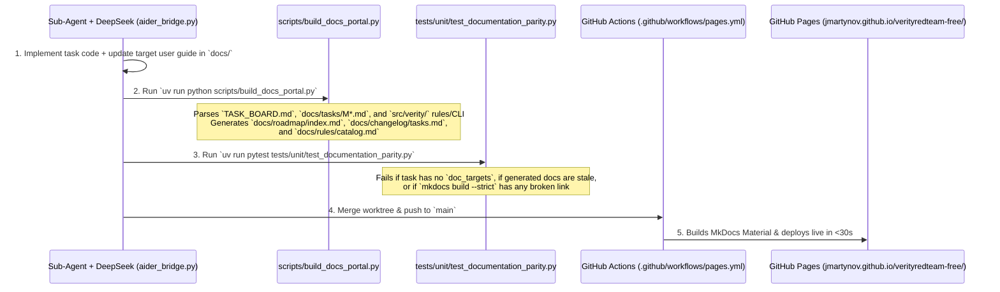

# Proposal: `verityredteam-free` Web Documentation Portal & Automated Task-to-Docs Pipeline

> **Target Repository**: [`/Users/ivan/Project/3t.tools.intellij/verityredteam-free`](file:///Users/ivan/Project/3t.tools.intellij/verityredteam-free) (`verity-redteam-core`, Apache-2.0, Public)
> **Live GitHub Pages URL**: `https://jmartynov.github.io/verityredteam-free/`
> **GitHub Project Board**: Board `#5` (`Verity RedTeam Free Task Board`, `PVT_kwHOD-xmQM4Br351`)

---

## 1. Research Findings: `verityredteam-free` Current State

Our sub-agent inspected [`verityredteam-free`](file:///Users/ivan/Project/3t.tools.intellij/verityredteam-free) (`README.md`, `TASK_BOARD.md`, `docs/`, `src/verity/`, and `tests/unit/test_documentation_parity.py`):

1. **Repository & Visibility**:
   - **Public** GitHub repository (`https://github.com/JMartynov/verityredteam-free`), meaning GitHub Pages is **100% free and publicly accessible** as soon as `.github/workflows/pages.yml` is pushed.
   - Currently has **4 workflows** (`ci.yml`, `full-tests.yml`, `e2e-containers.yml`, `workflow.yaml` for PyPI) and **no GitHub Pages deployment workflow**.
2. **Existing Documentation Assets**:
   - [`README.md`](file:///Users/ivan/Project/3t.tools.intellij/verityredteam-free/README.md) (~40 KB): Massive single-file monolith containing hero badges, CLI reference, SAST/AST rule tables, SQL Guard dialects, MCP server setup, and architecture diagrams.
   - [`TASK_BOARD.md`](file:///Users/ivan/Project/3t.tools.intellij/verityredteam-free/TASK_BOARD.md): Milestone registry linked to GitHub Project Board `#5` (`PVTI_...` item IDs).
   - [`docs/extensibility.md`](file:///Users/ivan/Project/3t.tools.intellij/verityredteam-free/docs/extensibility.md), [`docs/releases/v0.2.0.md`](file:///Users/ivan/Project/3t.tools.intellij/verityredteam-free/docs/releases/v0.2.0.md), [`docs/assets/demo.gif`](file:///Users/ivan/Project/3t.tools.intellij/verityredteam-free/docs/assets/demo.gif), and task specs in [`docs/tasks/`](file:///Users/ivan/Project/3t.tools.intellij/verityredteam-free/docs/tasks/).
3. **Existing Automated Documentation Parity Guard ([`tests/unit/test_documentation_parity.py`](file:///Users/ivan/Project/3t.tools.intellij/verityredteam-free/tests/unit/test_documentation_parity.py))**:
   - `verityredteam-free` **already has a 177-test deterministic parity suite** that verifies `README.md`, `TASK_BOARD.md`, `docs/tasks/M*.md`, static rule IDs (`VERITY-STATIC-*`), AST rule IDs (`VERITY-AST-*`), and demo CWEs (`CWE-89`, `CWE-639`, `CWE-943`, `CWE-94`).
   - Our web documentation portal and per-task publisher can hook directly into `test_documentation_parity.py` so **no task can pass `uv run pytest` unless its web documentation page and task changelog entry are published and valid**.

---

## 2. Technology Stack Comparison (Evaluated with DeepSeek)

| Criterion | Option A: **MkDocs Material** *(Recommended)* | Option B: **VitePress** | Option C: **Astro Starlight** |
| :--- | :--- | :--- | :--- |
| **Toolchain in `verityredteam-free`** | **100% Python (`uv run --group docs mkdocs build`)** — zero `package.json` or Node.js needed | Requires Node.js + `npm`/`pnpm` alongside `uv` | Requires Node.js + `npm`/`pnpm` alongside `uv` |
| **Design & Aesthetics** | Modern Dark/Light Slate & Cyber-Indigo theme, sticky top navigation tabs, instant SPA navigation, code copy/annotations, terminal animations (`demo.gif`) | Minimal Vue/Vite docs theme | High-contrast Astro docs theme |
| **Search Experience** | **Instant client-side search (`/` or `⌘K`)** with fuzzy matching, rule ID lookup (`VERITY-AST-CWE-94-EVAL`), CLI flag search, and task tag filtering | Client-side MiniSearch (`⌘K`) | Pagefind static WASM search (`⌘K`) |
| **Automated Task-to-Docs Integration** | Pure Python script (`scripts/build_docs_portal.py`) runs in `pytest` (`test_documentation_parity.py`) and MkDocs build hooks | Requires separate Python-to-Node build bridge | Requires separate Python-to-Astro content sync |
| **Mermaid, Alerts & Math** | Native support for `mermaid` diagrams, GitHub alerts (`> [!NOTE]`, `> [!IMPORTANT]`), and code tabs | Needs community Markdown plugins | Needs Astro integrations |

> [!TIP]
> **Why MkDocs Material is the Ideal Fit for `verityredteam-free`**:
> Keeping `verityredteam-free` 100% Python (`uv`) means contributors and sub-agents can preview (`uv run mkdocs serve`), build (`uv run mkdocs build --strict`), and verify (`uv run pytest tests/unit/test_documentation_parity.py`) the entire web documentation portal in `< 2 seconds` without installing Node.js.

---

## 3. Portal Architecture & Modern Visual Structure

Instead of forcing users to scroll a 40 KB `README.md`, the web portal breaks `verityredteam-free` into a **clean, structured 6-section documentation site** with instant search and cross-linked ecosystem tabs:

```mermaid
flowchart TD
    Home["verity-redteam-core Docs Portal\n(jmartynov.github.io/verityredteam-free/)"]
    Home --> S1["1. Getting Started"]
    Home --> S2["2. CLI & CI/CD Reference"]
    Home --> S3["3. SAST & AST Rule Catalog"]
    Home --> S4["4. SQL Security Guard & Targets"]
    Home --> S5["5. MCP Server & Extensibility"]
    Home --> S6["6. Task Hub & Release Ledger\n(Auto-Published per Task)"]

    S1 --> S1a["Overview & Deterministic Architecture"]
    S1 --> S1b["Installation (pip, uvx, Homebrew, Docker)"]
    S1 --> S1c["60-Second Quickstart & Live Demo (verity test --demo)"]

    S2 --> S2a["verity scan (Workstation & Repo Discovery)"]
    S2 --> S2b["verity test (Zero-Docker Target Harness)"]
    S2 --> S2c["verity serve (Pure-Stdlib MCP Server)"]
    S2 --> S2d["GitHub Action, Pre-Commit & SARIF / Baseline Flows"]

    S3 --> S3a["13 Static Screening Rules (VERITY-STATIC-*)"]
    S3 --> S3b["9 Python AST Security Rules (VERITY-AST-*)"]
    S3 --> S3c["TypeScript/JS, Agent Skills & ANSI/Unicode Rules"]

    S4 --> S4a["SqlSecurityGuard (7 SQL Dialects)"]
    S4 --> S4b["4 Zero-Docker Vulnerable Targets (CWE-89, 639, 943, 94)"]

    S5 --> S5a["IDE Onboarding (Antigravity, Claude, Cursor, Windsurf)"]
    S5 --> S5b["Plugin & Custom Rule Extensibility (docs/extensibility.md)"]

    S6 --> S6a["Interactive Milestone Dashboard (M7–M38+)"]
    S6 --> S6b["Per-Task Specs & ATDD Verification Cards"]
    S6 --> S6c["Automated Task Changelog & Release Notes"]
```

### Modern Design & UX Features
- **Hero Landing Page (`docs/index.md`)**: Modern glassmorphic hero cards, terminal recording (`docs/assets/demo.gif`), 1-click copy install snippet (`uvx verity-redteam-core scan`), and live statistics badges (Rules Count, SQL Dialects, Passports, OSV Advisories, Completed Milestones).
- **Instant Rule & CWE Lookup**: Typing `CWE-502`, `pickle`, `VERITY-STATIC-TOOL-POISONING`, or `--sarif` into the `/` search bar jumps straight to the rule's remediation example and AST pattern.
- **Ecosystem Header Links**: Top navigation bar links directly to companion open-source portals:
  - **MCP Fingerprints Explorer** (`https://jmartynov.github.io/mcp-fingerprints/`)
  - **MCP Vulnerability Intelligence** (`https://jmartynov.github.io/mcp-vulnerabilities/`)
  - **PyPI Package** (`https://pypi.org/project/verity-redteam-core/`)

---

## 4. How Every Task Automatically Publishes to the Web Documentation

Every task in `verityredteam-free` (`M7`..`M38+` in `docs/tasks/M*.md` and `TASK_BOARD.md`) will automatically publish to the documentation site through a **3-part deterministic pipeline**:

### What Gets Published Automatically When a Task Completes:
1. **Feature Documentation Update (`doc_targets` Contract)**:
   - Every task file in `docs/tasks/M<NN>_<slug>.md` specifies a `doc_targets:` list in its frontmatter/header pointing to the user-facing guide page(s) it updates (e.g., `M30` updates `docs/getting-started/installation.md`; `M33` updates `docs/rules/typescript-sast.md`).
2. **Auto-Generated Milestone & Task Dashboard (`docs/roadmap/index.md`)**:
   - `scripts/build_docs_portal.py` reads `TASK_BOARD.md` and `docs/tasks/M*.md` to render a visual progress dashboard with status pills (`Done`, `Ready`, `In Progress`), GitHub Project Board `#5` links (`PVTI_...`), and 1-click links to each task's specification and ATDD matrix.
3. **Auto-Generated Task Release Feed (`docs/changelog/tasks.md`)**:
   - Whenever a task transitions to `Done`, `scripts/build_docs_portal.py` publishes a structured release card to the **Task Release Feed** showing the task summary, the acceptance criteria (`AC-NN.1`..`AC-NN.K`) verified, and clickable links to the updated documentation pages.
4. **Auto-Generated Live Rule & CLI Catalog (`docs/rules/catalog.md`)**:
   - Introspects `src/verity/screening/` and `src/verity/guards/` at build time so every new SAST/AST rule or SQL dialect added by future tasks (`M33`–`M37`) appears automatically in the searchable Rule Catalog table.
5. **Enforced by `test_documentation_parity.py`**:
   - We extend `tests/unit/test_documentation_parity.py` so any task marked `Done` in `TASK_BOARD.md` / `docs/tasks/M*.md` is verified to have:
     - Valid `doc_targets` pointing to existing `.md` pages in `docs/`.
     - An up-to-date entry in the generated portal index (`scripts/build_docs_portal.py --check`).
     - Zero broken internal links in `mkdocs.yml` navigation.

---

## 5. Step-by-Step Implementation Plan (via Sub-Agents & DeepSeek)

Once you approve this proposal, we will execute it incrementally in `verityredteam-free`:

1. **Step 1 — Register Milestone `M38` (`Web Documentation Portal & Automated Task-to-Docs Publisher`)**:
   - Add `M38` (`docs/tasks/M38_web_documentation_portal_and_task_publisher.md`) to `verityredteam-free/TASK_BOARD.md` (alongside syncing `M30`–`M38` cleanly with GitHub Project Board `#5`).
2. **Step 2 — ATDD Red → Lock (`tests/unit/test_docs_portal_generator.py`)**:
   - Author locked acceptance tests verifying:
     - `AC-38.1`: `scripts/build_docs_portal.py` deterministically generates `docs/roadmap/index.md`, `docs/changelog/tasks.md`, and `docs/rules/catalog.md` from `TASK_BOARD.md`, `docs/tasks/M*.md`, and `src/verity/`.
     - `AC-38.2`: Structured user guides (`docs/index.md`, `docs/getting-started/`, `docs/cli/`, `docs/rules/`, `docs/guards/`, `docs/mcp/`) cover all CLI subcommands, 13 static rules, 9 AST rules, 7 SQL dialects, and 4 zero-Docker targets.
     - `AC-38.3`: `mkdocs.yml` configuration validates cleanly and `mkdocs build --strict` exits `0` with client-side search index generated (`site/search/search_index.json`).
     - `AC-38.4`: `.github/workflows/pages.yml` builds and deploys the site to GitHub Pages on push to `main`.
     - `AC-38.5` *(Paired Benign Control)*: A task spec with invalid/missing `doc_targets` or stale generated docs is deterministically caught by `--check` without modifying unrelated files.
3. **Step 3 — 2-Pass DeepSeek Implementation (`aider_bridge.py` in isolated worktree)**:
   - Implement `scripts/build_docs_portal.py`, `mkdocs.yml`, structured `docs/` pages, `.github/workflows/pages.yml`, and `test_documentation_parity.py` hooks via Pass 1 + Pass 2 DeepSeek self-review.
4. **Step 4 — Verification, Merge & Live GitHub Pages Activation**:
   - Run all `verityredteam-free` gates (`uv run pytest tests/`, `uv run ruff check src tests`, `uv run verity test --demo`, and `uv run mkdocs build --strict`), merge to `main`, push, and enable GitHub Pages workflow deployment via `gh api`.
